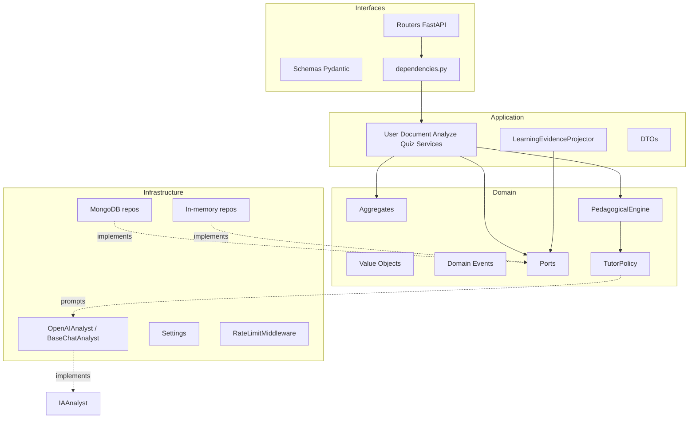
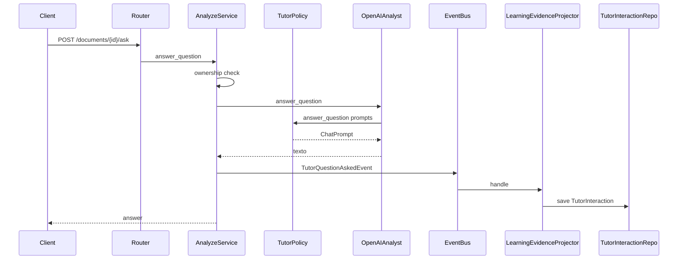

# Arquitectura del sistema (Backend LARIA)

> Al día a 14-oct-2026. Los diagramas de archify (con cada nodo citando su archivo y línea)
> están en [`docs/diagramas/`](../../docs/diagramas/):
> [arquitectura](../../docs/diagramas/laria-arquitectura.png) ·
> [turno del chat](../../docs/diagramas/laria-turno-chat.png) ·
> [la clase por tramos](../../docs/diagramas/laria-clase-tramos.png) ·
> [evidencia](../../docs/diagramas/laria-evidencia.png) ·
> [datos](../../docs/diagramas/laria-datos.png) ·
> [borrar una cuenta](../../docs/diagramas/laria-borrar-cuenta.png).
> Los mermaid de este documento son más antiguos y esquemáticos.

## Principios

1. **LARIA es un tutor**, no un chatbot: el objetivo es que el estudiante aprenda.
2. **El modelo de IA solo genera lenguaje.** La inteligencia educativa está en dominio/aplicación (`TutorPolicy`, evidencia, ownership, grading).
3. **DDD + Clean Architecture + SOLID**: el dominio no depende de FastAPI, Mongo ni OpenAI.
4. **Inversión de dependencias**: puertos en `domain/ports`; adaptadores en `infrastructure/`.

## Capas

| Capa | Responsabilidad | No debe |
|------|-----------------|--------|
| `interfaces` | HTTP, validación de entrada, mapeo a DTO/schema | Contener reglas de grading/ownership de negocio |
| `application` | Orquestar casos de uso, publicar/suscribir evidencia | Conocer detalles HTTP o SQL/BSON |
| `domain` | Invariantes, agregados, eventos, política de prompts | Importar FastAPI/Motor/httpx |
| `infrastructure` | I/O real (DB, OpenAI, rate limit, config) | Definir reglas pedagógicas “de negocio” más allá del transporte |

## Aggregates principales

| Aggregate | Rol |
|-----------|-----|
| `UserAggregate` | Identidad, roles (`student`/`admin`), password hashing |
| `DocumentAggregate` | Material del estudiante, estado de análisis, ownership |
| `QuizAggregate` | Preguntas MCQ, grading server-side |
| `QuizAttemptAggregate` | Intento calificado + evento `QuizAttemptCompletedEvent` |
| `TutorInteractionAggregate` | Evidencia Q&A tutor |
| `StudentProfile` | Perfil cognitivo: dominio por concepto, nivel por tema, memoria pedagógica, preferencias. Lo escribe solo el projector |
| `LearningPathAggregate` | La clase: módulos por tramo (`basico → intermedio → avanzado`), estado de enseñanza, `next_tier` ([ADR-028](adr/ADR-028-la-clase-ruta-y-ciclo-de-ensenanza.md), [ADR-037](adr/ADR-037-rutas-por-tramos.md)) |
| `ChatAggregate` | Conversación con mensajes embebidos y resumen de lo antiguo |
| `TutorSessionAggregate` | Estado multi-turno del tutor sobre un documento |
| `StudyDay` | Segundos estudiados por día |
| `ConceptGraph` | Grafo curado de prerrequisitos ([ADR-005](adr/ADR-005-grafo-prerrequisitos-curado.md)) |

El análisis vive **en el documento** (`analysis_result`), no en un bounded context Analysis separado (eliminado por deuda).

## Puertos relevantes

- Repositorios (`repositories.py`): `User`, `Document`, `Quiz`, `QuizAttempt`, `TutorInteraction`, `StudentProfile`, `ConceptGraph`, `TutorSession`, `Chat`, `LearningPath`, `StudyTime`
- `IAAnalyst`: `analyze`, `answer_question`, `generate_quiz`, `generate_diagnostic`
- `LessonGenerator`: explicación + comprobación de la clase y temario por tramo
- `CurriculumResearcher` / `CurriculumResearchRepository`: temario investigado en la web, con caché global ([ADR-039](adr/ADR-039-temario-investigado.md))
- `ContentModerator`: filtro de temas y mensajes antes del modelo ([ADR-036](adr/ADR-036-filtro-de-temas.md))
- `DocumentBlobStore`: texto extraído (GridFS) y original (R2) ([ADR-012](adr/ADR-012-texto-y-original.md))
- `ExternalIdentityVerifier`: Google y Clerk
- `ChatTitleGenerator`, `ConversationSummarizer`, `CachePort`, `MetricsPort`
- `TextToSpeechPort` y el resto de `embodiment.py` (la voz funciona; presencia y sensores, apagados)
- `EventBus`: publish/subscribe de eventos de dominio (memoria u outbox en Mongo)

## Flujo típico: preguntar al tutor

## Seguridad (corte transversal)

- Arranque fail-closed: `SECRET_KEY` segura + `OPENAI_API_KEY` + solo `IA_PROVIDER=openai`.
- JWT algoritmo **HS256 fijado en código** (`JWT_ALGORITHM`), no configurable por env.
- Rate limiting por IP en auth y rutas de documentos/quizzes.
- Mensajes de registro sin enumeración de email/username.
- Login con bcrypt dummy si el usuario no existe (mitiga timing).
- Docs/OpenAPI detrás de `ENABLE_DOCS`.
- FastAPI `debug=False` siempre (sin stack traces al cliente).
- Mongo en Compose: autenticado, **sin** publicar `27017` al host.
- Contenedor app corre como usuario no-root.
- **Clerk:** la sesión se verifica con JWKS. Borrar una cuenta de Clerk exige una verificación de identidad de ≤ 10 min (`fva`) y borra primero el usuario en Clerk ([ADR-041](adr/ADR-041-borrar-cuentas-de-clerk.md)).
- **CORS:** lista exacta (`CORS_ORIGINS`) más un patrón para las vistas previas de Vercel (`CORS_ORIGIN_REGEX`), que debe ir anclado y no dejar pasar orígenes ajenos: si no, la app no arranca.
- **Contenido:** la moderación de OpenAI filtra temas y mensajes antes del modelo; ante señales de autolesión responde siempre con apoyo ([ADR-036](adr/ADR-036-filtro-de-temas.md)).
- **Abusos de evaluación y chat:** una nivelación o prueba de paso se responde una vez (409); el cliente no puede escribir mensajes `assistant`; mensajes de hasta 20 000 caracteres; la prueba de paso, 6 por minuto ([ADR-043](adr/ADR-043-cerrar-abusos-de-evaluacion-y-chat.md), [ADR-046](adr/ADR-046-tope-del-chat-20000.md)).
- **Validación de producción:** `validate_security_settings` solo exige Redis, outbox, rate limit y CORS sin comodín cuando `APP_ENV=production`. **El servicio de Render corre hoy con `APP_ENV=development`**, así que esas comprobaciones no se ejecutan (ver `deploy-render.md`).

## Persistencia dual

`DB_PROVIDER=memory` (default local/tests) o `mongodb` (Compose/prod). Los puertos son los mismos; DI en `dependencies.py` elige el adaptador.

## Logging operativo

- `configure_logging()` en arranque (`LOG_LEVEL`, `LOG_FORMAT=text|json`).
- `RequestLoggingMiddleware`: método, path, status, `X-Request-Id`, duración (sin bodies ni tokens).
- Loggers: `laria.http`, `laria.pedagogy`, `laria.llm`, `laria.learning`.
- Distinto de `/metrics` (contadores); los logs son traza operativa.

## Evidencia y perfil cognitivo (estado actual)

`LearningEvidenceProjector` suscribe:

- `QuizAttemptCompletedEvent` → mastery multi-señal por concepto + interacción
- `TutorQuestionAskedEvent` → struggle/ayuda/latencia + memoria pedagógica

`StudentProfile` mantiene `ConceptMastery` con `effective_mastery` (curva del olvido), confianza y `PedagogicalMemory`.

`PedagogicalEngine` decide modo, dificultad dinámica, estilo cognitivo y gate de prerrequisitos **antes** de llamar al LLM (`TutorPolicy` solo compone prompts).

Reglas de contabilidad de esa evidencia (ADR-007 a ADR-009):

- **Se pesa por calidad:** un auto-reporte ("no entiendo") vale la mitad de un ítem calificado.
  `weighted_evidence` decide si un concepto informa la decisión (≥ 1.0) o es un hueco (≥ 2.0).
- **Un turno es una observación:** la latencia alta penaliza la muestra del turno en vez de añadir
  otra, y la velocidad se actualiza una vez por evento, no por concepto etiquetado.
- **El progreso no se declara:** `pace` tiene un único escritor (`_update_pace`) y el mastery de una
  ruta de aprendizaje se proyecta del perfil en cada lectura.
- **El canal positivo está cableado:** un concepto que cruza a dominado se reconoce una vez
  (`celebrated_concepts`, envelope `celebration`, afecto `CELEBRATORY`).
- **La adaptación está encendida:** desde la fase D (`ADAPT_SHADOW_MODE=False` por defecto) el
  fragmento prompt-shaping llega al modelo y `payload.explanation` le dice al estudiante por qué se
  le habla así. Poner la variable a `true` vuelve al modo sombra —señales computadas, prompt
  intacto— sin desplegar: es el interruptor de emergencia, y hay un test que lo protege.

APIs:

- `GET /api/v1/learning/me` — historial + recomendaciones (`RecommendationEngine`)
- `GET /api/v1/learning/me/profile` — mastery efectivo, confianza, memoria
- `GET /metrics` — métricas del sistema (tokens, cache, conceptos)

## Qué subsistema sale de cada ADR (desde septiembre)

| Subsistema | ADR | Dónde vive |
|------------|-----|-----------|
| Nivelación sin material y calibrada por rondas | [016](adr/ADR-016-diagnostico-de-entrada.md), [031](adr/ADR-031-nivelacion-calibrada.md) | `diagnostic_planner.py`, `quiz_service.py` |
| La clase: ruta, explicación y comprobación | [028](adr/ADR-028-la-clase-ruta-y-ciclo-de-ensenanza.md) | `teaching_policy.py`, `teaching_service.py` |
| Repaso por olvido | [032](adr/ADR-032-repaso-espaciado.md) | `TeachingPolicy.due_review` |
| Cómo seguir tras una ruta | [034](adr/ADR-034-como-seguir-tras-una-ruta.md) | `teaching_service.next_suggestions` |
| Filtro de temas y apoyo | [036](adr/ADR-036-filtro-de-temas.md) | `content_safety_service.py`, `openai_moderator.py` |
| Rutas por tramos | [037](adr/ADR-037-rutas-por-tramos.md) | `learning_path.py` (`TIERS`, `next_tier`) |
| Tutorial guardado en la cuenta | [038](adr/ADR-038-tutorial-de-bienvenida.md) | `POST /users/me/onboarding` |
| Temario investigado en la web | [039](adr/ADR-039-temario-investigado.md) | `web_researcher.py`, `curriculum_research` |
| Que el tutor no se repita | [040](adr/ADR-040-que-el-tutor-no-se-repita.md) | `repetition.py`, `TutorPolicy` |
| Borrar cuentas de Clerk | [041](adr/ADR-041-borrar-cuentas-de-clerk.md) | `account_service.py` |
| Prueba de paso de la ruta | [042](adr/ADR-042-prueba-de-paso-de-la-ruta.md) | `TeachingService.passage_test` |
| Cerrar abusos | [043](adr/ADR-043-cerrar-abusos-de-evaluacion-y-chat.md) | `quiz_service.py`, `chat_schemas.py`, `rate_limit.py` |
| Reintentar no es evidencia | [044](adr/ADR-044-reintentar-no-es-evidencia.md) | `LearningEvidenceProjector._es_reintento` |
| Reparto y rúbrica de la ronda avanzada | [045](adr/ADR-045-reparto-y-rubrica-de-la-ronda-avanzada.md) | `fit_to_plan`, `_RUBRICA_DIFICULTAD` |
| Tope del chat a 20 000 | [046](adr/ADR-046-tope-del-chat-20000.md) | `chat_schemas.py` |
| Render despliega `main` | [047](adr/ADR-047-render-despliega-main.md) | `render.yaml` |
| Esquemas en las explicaciones | [048](adr/ADR-048-esquemas-en-las-explicaciones.md) | `visuals.py`, `chat_tutor_service._con_esquemas`, `/lesson` |

## Modelo OpenAI y economía

- Default: `OPENAI_MODEL_DEFAULT` / `OPENAI_MODEL` = `gpt-4o-mini`
- Investigación del temario: `OPENAI_MODEL_RESEARCH` = `gpt-4o` con `web_search`; voz: `TTS_MODEL` = `gpt-4o-mini-tts`; moderación: `omni-moderation`
- Fuerte: `OPENAI_MODEL_STRONG` vía `ModelRouter` (struggle alto, socrático+hard)
- `LlmGate` + `CachePort`: reutiliza análisis/quizzes/respuestas equivalentes; invalida por hash de contenido y versión de política
- Ver ADR-001 y ADR-003
