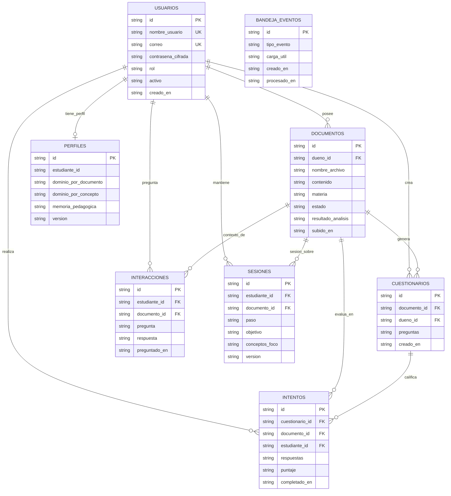
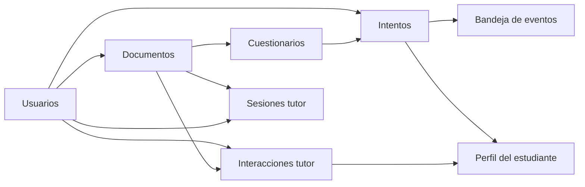

# Esquema MongoDB — LARIA Backend

Base de datos: `laria_db` (configurable con `MONGODB_DB_NAME`).  
Cliente: Motor (async). IDs de dominio: UUID en string. No hay joins nativos; las relaciones son por referencia lógica.

Fuente de verdad: repositorios en `src/infrastructure/mongodb/` e índices en `indexes.py` (rama `feature/backend`).

## Diagrama de relaciones

Etiquetas en español. Los nombres reales de colección en Mongo están en la leyenda debajo / en las secciones de colecciones.



Nombres reales en Mongo: `users`, `documents`, `quizzes`, `quiz_attempts`, `tutor_interactions`, `tutor_sessions`, `student_profiles`, `event_outbox`, más GridFS `fs.files` / `fs.chunks` para el cuerpo del material. El análisis va embebido en `documents.analysis_result`.

## Colecciones

### `users`

| Campo | Tipo | Notas |
|-------|------|--------|
| `_id` | string (UUID) | PK |
| `username` | string | índice único |
| `email` | string | índice único |
| `hashed_password` | string | bcrypt |
| `role` | `"student"` \| `"admin"` | legado `"teacher"` → student |
| `is_active` | bool | |
| `created_at` | datetime | |

### `documents`

| Campo | Tipo | Notas |
|-------|------|--------|
| `_id` | string (UUID) | PK |
| `owner_id` | string (UUID) | → `users._id`; índice |
| `filename` | string | |
| `content` | string | vacío si hay blob; legacy inline; omitido en listados |
| `content_blob_id` | string \| null | ObjectId hex de GridFS (`fs.files`) |
| `subject` | string | p. ej. materia |
| `status` | `uploaded` \| `analyzing` \| `analyzed` \| `error` | |
| `uploaded_at` | datetime | |
| `analysis_result` | object \| ausente | embebido (no colección aparte) |
| `error_message` | string \| null | |

### GridFS (`fs.files` / `fs.chunks`)

Cuerpo del material (hasta `DOCUMENT_MAX_UPLOAD_BYTES`, 25 MiB por defecto). Evita el límite BSON de 16 MB en `documents`. Guarda el **texto extraído** (`content_blob_id`) y, si `ORIGINAL_STORAGE=blob`, también el archivo original (`original_blob_id`); con `ORIGINAL_STORAGE=r2` el original vive en Cloudflare R2 ([ADR-012](adr/ADR-012-texto-y-original.md)).

**`analysis_result` embebido:**

| Campo | Tipo |
|-------|------|
| `summary` | string |
| `key_concepts` | string[] |
| `suggested_questions` | string[] |
| `confidence_score` | float |

> El bounded context `AnalysisRepository` / colección `analyses` fue eliminado (ADR-001). Puede quedar bytecode legado en árboles locales; no forma parte del modelo actual.

### `quizzes`

| Campo | Tipo | Notas |
|-------|------|--------|
| `_id` | string (UUID) | PK |
| `document_id` | string | → `documents._id`; índice |
| `owner_id` | string | → `users._id`; índice |
| `questions` | array | ver abajo |
| `created_at` | datetime | |

**Elemento de `questions`:**

| Campo | Tipo |
|-------|------|
| `text` | string |
| `options` | object `{ "A": "...", "B": "..." }` |
| `correct_answer` | string |
| `difficulty` | `easy` \| `medium` \| `hard` |
| `concept_tags` | string[] |

### `quiz_attempts`

| Campo | Tipo | Notas |
|-------|------|--------|
| `_id` | string (UUID) | PK |
| `quiz_id` | string | → `quizzes._id` |
| `document_id` | string | → `documents._id`; índice |
| `student_id` | string | → `users._id`; índice |
| `answers` | object | claves índice pregunta → opción |
| `per_question_correct` | bool[] | |
| `score` | int | |
| `total_points` | int | |
| `completed_at` | datetime | |

### `tutor_interactions` (persistencia de conversación Q&A)

| Campo | Tipo | Notas |
|-------|------|--------|
| `_id` | string (UUID) | PK |
| `student_id` | string | índice |
| `document_id` | string | índice |
| `question` | string | |
| `answer` | string | |
| `asked_at` | datetime | |

Cada `POST /documents/{id}/ask` genera evidencia vía eventos y se proyecta aquí.

### `tutor_sessions` (estado multi-turno del tutor)

| Campo | Tipo | Notas |
|-------|------|--------|
| `_id` | string | `{student_id}:{document_id}` (único compuesto) |
| `id` | string (UUID) | id de dominio |
| `student_id` | string | |
| `document_id` | string | índice |
| `step` | string | p. ej. `introduce` |
| `objective` | string | |
| `focus_concepts` | string[] | |
| `hints_given` | string[] | |
| `turns` | int | |
| `updated_at` | datetime | |
| `version` | int | concurrency optimista |

### `student_profiles` (perfil cognitivo / memoria educativa)

| Campo | Tipo | Notas |
|-------|------|--------|
| `_id` | string | = `student_id` |
| `student_id` | string | |
| `mastery_by_document` | map | clave = document_id |
| `mastery_by_concept` | map | clave = concept_key |
| `frequent_errors` | string[] | |
| `pace` | string | default `steady` |
| `total_attempts` | int | |
| `total_struggle_signals` | int | |
| `learning_velocity` | float | una observación por evento (ADR-009) |
| `pedagogical_memory` | object | ver abajo |
| `applied_event_ids` | string[] | dedup de eventos (máx. 256) |
| `celebrated_concepts` | string[] | hitos ya reconocidos al estudiante (ADR-009) |
| `last_interaction_at` | datetime \| null | fuente única de `interaction_gap_ms` (ADR-004) |
| `last_answer_length` | int | largo de la última respuesta entregada |
| `adaptive_signals` | map | clave = `SignalKind`; `{value, samples}` (ADR-004) |
| `updated_at` | datetime | |
| `version` | int | concurrency optimista |

**`mastery_by_document[docId]`:** `document_id`, `attempts`, `mastery`, `last_score_ratio`, `incorrect_streak`, `struggle_signals`.

**`mastery_by_concept[key]`:** `concept_key`, `attempts`, `mastery`, `last_score_ratio`, `document_ids[]`, `confidence`, `last_practiced_at`, `help_requests`, `latency_ms_ema`, `error_streak`, `subject`, `evidence_count`, `weak_evidence_count`, `half_life_days`, `last_reviewed_at`, `review_log[]` (`{at, score_ratio, half_life_days}`, como mucho 30; ADR-051).
Los dos últimos son nuevos y opcionales: un perfil anterior no los trae y se lee sin historial (no hay migración).

`weak_evidence_count` es el subconjunto de `evidence_count` que **no** vino de un ítem calificado
(auto-reporte, latencia, chat). La evidencia se pesa con
`measured + 0.5 × weak` ([ADR-007](adr/ADR-007-evidencia-ponderada-por-calidad.md)); los documentos
escritos antes de ese ADR lo tienen implícitamente en `0`.

**`pedagogical_memory`:** `frequent_misconceptions[]`, `successful_examples[]`, `successful_analogies[]`, `preferred_explanation_style`, `last_effective_strategies[]`.

### `event_outbox` (bus async)

| Campo | Tipo | Notas |
|-------|------|--------|
| `_id` | string (UUID) | PK |
| `event_type` | string | p. ej. `QuizAttemptCompletedEvent` |
| `payload` | object | evento serializado |
| `created_at` | datetime | |
| `processed_at` | datetime \| null | índice |
| `attempts` | int | reintentos |
| `last_error` | string \| null | |

Activo cuando `EVENT_BUS_BACKEND=outbox`.

### `learning_paths` (la clase: ruta por tramos)

Una por tema y estudiante ([ADR-028](adr/ADR-028-la-clase-ruta-y-ciclo-de-ensenanza.md), [ADR-037](adr/ADR-037-rutas-por-tramos.md)).

| Campo | Tipo | Notas |
|-------|------|-------|
| `_id` | string (UUID) | |
| `owner_id` | string (UUID) | Índice. Ajena → 404 |
| `subject`, `title`, `topic` | string | `topic` canónico: con él se busca el nivel en el perfil |
| `modules` | array | `concept`, `title`, `difficulty`, `prerequisites`, `tier`, `key_points`, `sources`. El `mastery` y el `status` **no** se guardan: se proyectan del perfil al leer ([ADR-008](adr/ADR-008-progreso-derivado-no-declarado.md)) |
| `tiers` | array de string | Tramos abiertos: `basico`, `intermedio`, `avanzado` |
| `teaching` | objeto | Estado de la clase: `phase`, `concept`, `variant`, `pending_check_quiz_id`, `lesson_markdown`, rachas y conceptos superados |
| `next_topics` | array | Sugerencias de cómo seguir ([ADR-034](adr/ADR-034-como-seguir-tras-una-ruta.md)) |
| `created_at`, `updated_at` | datetime | |

Borrar una clase borra este documento y nada más: lo aprendido sigue en `student_profiles`.

### `chats` (conversaciones)

| Campo | Tipo | Notas |
|-------|------|-------|
| `_id` | string (UUID) | |
| `owner_id` | string (UUID) | Índice |
| `title` | string | |
| `document_id` | string \| null | Material vinculado; sin él, conversación libre |
| `messages` | array **embebido** | `role`, `content` (hasta 20 000 caracteres), `metadata` (envelope del tutor), `created_at` |
| `summary`, `summary_upto` | string, int | Resumen de lo más antiguo, para no mandar todo el historial al modelo |
| `created_at`, `updated_at` | datetime | Índice en `updated_at` |

Los mensajes viven **dentro** del chat. Es la colección que más crece y la única con un techo por documento: MongoDB no admite documentos de más de 16 MB (ver [Volumen](#volumen-y-capacidad)).

### `curriculum_research` (temarios investigados, caché global)

Un documento por `tema:nivel`, compartido por todos los estudiantes ([ADR-039](adr/ADR-039-temario-investigado.md)).

| Campo | Tipo | Notas |
|-------|------|-------|
| `_id` | string | `"{topic}:{level}"` |
| `topic`, `level` | string | `level`: `intermedio` o `avanzado` |
| `modules` | array | Módulos con ideas clave y fuentes verificadas desde las citas de la búsqueda |
| `created_at` | datetime | |

### `study_time` (tiempo de estudio)

| Campo | Tipo | Notas |
|-------|------|-------|
| `_id` | string | `"{student_id}:{YYYY-MM-DD}"`: un documento por estudiante y día |
| `student_id` | string (UUID) | |
| `day` | string | Día en la zona horaria del estudiante |
| `seconds` | int | Cada aviso suma como mucho 60 s |
| `last_ping_at` | datetime | Para no contar doble con varias pestañas |

### `concept_graphs` (grafo de prerrequisitos curado)

Un solo documento compartido ([ADR-005](adr/ADR-005-grafo-prerrequisitos-curado.md)): `graph_id`, `edges` (prerrequisito → concepto), `aliases` (formas de escribir cada concepto), `version` y `updated_at`.

## Volumen y capacidad

Medido en Atlas el **14-oct-2026** (`dbStats` y `collStats`, solo lectura):

| | |
|---|---|
| En disco, con índices | **2.46 MB** |
| Datos sin comprimir | 1.00 MB |
| Usuarios | 46 |
| Documentos (todas las colecciones) | 653 |

Por colección (disco + índices): `fs.chunks` 0.31 MB · `chats` 0.29 · `quizzes` 0.27 · `tutor_interactions` 0.21 · `users` 0.18 · `quiz_attempts` 0.17 · `learning_paths` 0.17 · el resto, menos de 0.15 cada una.

**Qué crece y qué no:**
- **Crece con el uso:** `chats` (los mensajes van dentro; hoy el mayor pesa 48 KB), `fs.chunks` (texto extraído de cada documento subido, hasta 100 000 caracteres), `quizzes`, `quiz_attempts` y `tutor_interactions`.
- **Acotado:** `event_outbox` se vacía al procesar y al borrar una cuenta; `curriculum_research` es una caché por tema y nivel, compartida; `concept_graphs` es un documento.
- **Fuera de Atlas:** los archivos originales van a Cloudflare R2 y la caché de respuestas a Redis.

**Cuánto aguanta:** el plan gratuito de Atlas (M0) admite 512 MB. Al ritmo de hoy, ~0.05 MB por usuario, cabrían unos 10 000 usuarios como los actuales. Con un uso más intenso (documentos grandes y chats largos), una cifra prudente es **1–2 MB por usuario activo**, es decir, unos **250–500 usuarios** antes de acercarse al límite. Para revisarlo:

```bash
cd backend && python scripts/mongo_volumen.py   # imprime dbStats y el tamaño de cada colección
```

**Techo por chat:** con mensajes de hasta 20 000 caracteres, un chat llega al límite de 16 MB de MongoDB hacia los ~600 turnos con mensajes de tamaño máximo (unos 26 KB por turno: la pregunta, la respuesta y su envelope). Si eso llega a pasar, la solución es mover `messages` a su propia colección.

## Índices (arranque)

Definidos en `ensure_all_indexes()`:

| Colección | Índice |
|-----------|--------|
| `users` | `email` unique, `username` unique |
| `documents` | `owner_id` |
| `quizzes` | `document_id`, `owner_id` |
| `quiz_attempts` | `student_id`, `document_id` |
| `tutor_interactions` | `student_id`, `document_id` |
| `tutor_sessions` | `document_id`, unique `(student_id, document_id)` |
| `event_outbox` | `processed_at`, `(processed_at, created_at)` |

## Flujo de datos (cómo se conectan)



1. El estudiante (colección `users`) sube material → `documents`.
2. El análisis de OpenAI se guarda **dentro** del documento.
3. Cuestionario → `quizzes`; intento → `quiz_attempts` + evento en bandeja/memoria.
4. Pregunta al tutor → `tutor_interactions` + actualización de `tutor_sessions`.
5. El proyector de evidencia actualiza `student_profiles` (dominio + memoria pedagógica).

## Dualidad memory / mongodb

Con `DB_PROVIDER=memory` las mismas formas de documento viven en repositorios in-memory (tests/dev). El contrato de campos es idéntico al de Mongo.
